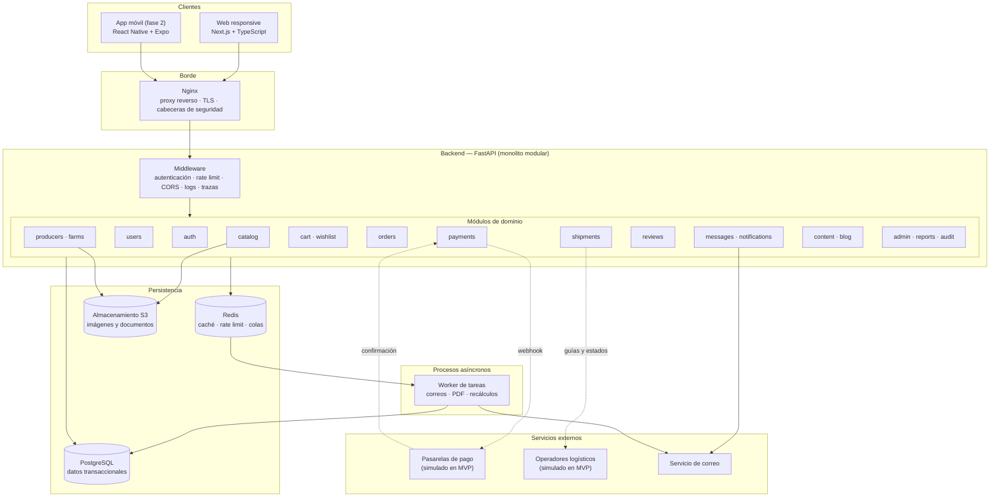
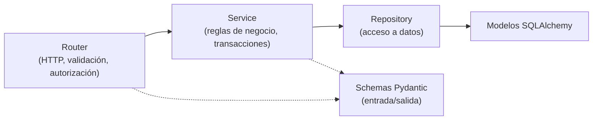
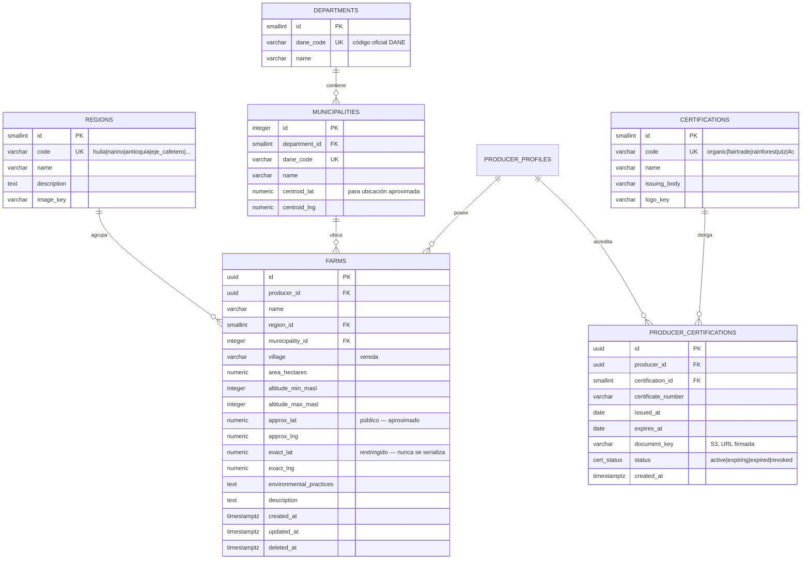
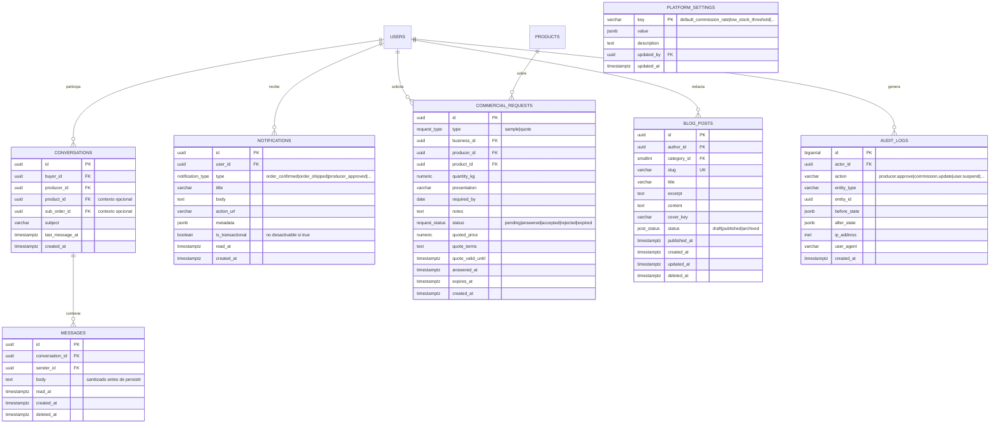
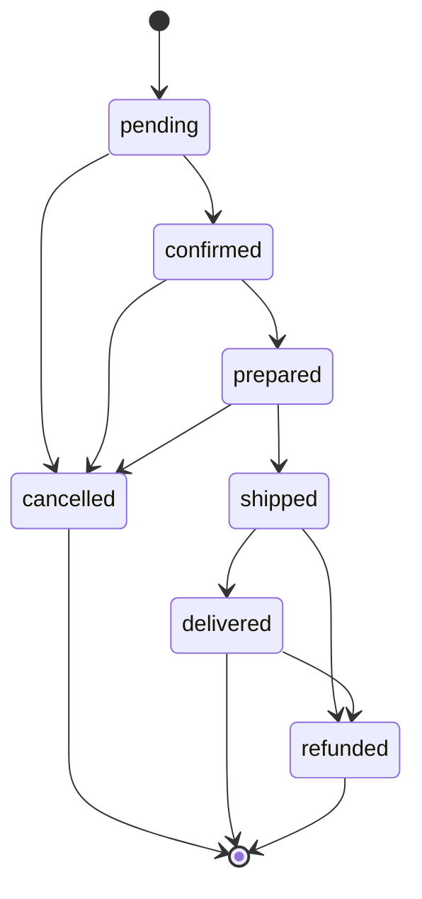
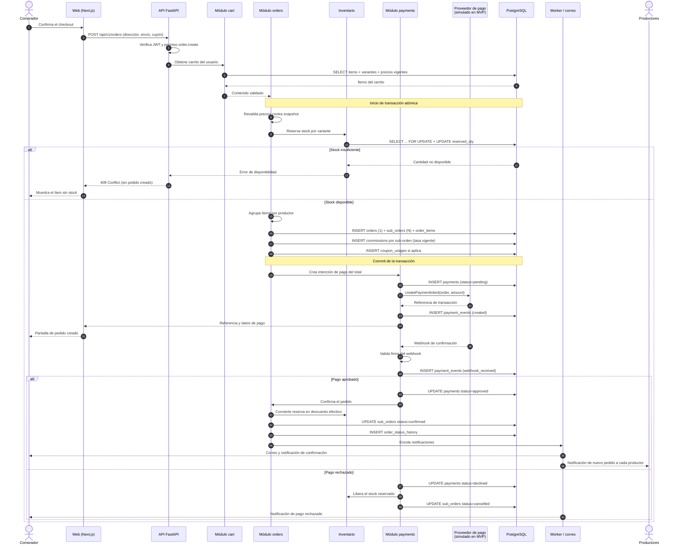

# MONK GRAIN — Fase 3: Arquitectura y Base de Datos

Traduce las [historias de usuario](02-historias-usuario.md) en estructura técnica: decisiones de arquitectura, componentes, modelo de datos y flujos críticos.

---

## 1. Decisiones de arquitectura (ADR)

Cada decisión queda registrada con su justificación, para no repetir el problema de los documentos previos donde el stack se declaraba distinto en cada artefacto.

### ADR-01 — Monolito modular en FastAPI, no microservicios
**Decisión:** el backend es una sola aplicación FastAPI organizada en módulos de dominio con fronteras explícitas.
**Motivo:** el MVP lo desarrolla un equipo reducido y el dominio aún está en validación. Los microservicios impondrían coste operativo (despliegue distribuido, consistencia eventual, trazas entre servicios) sin beneficio real a esta escala. Los módulos se diseñan con acoplamiento bajo para poder extraerse a servicios independientes cuando el volumen lo justifique.
**Consecuencia:** un solo despliegue, una sola base de datos, transacciones ACID locales — que es exactamente lo que el checkout atómico (HU-CC-07, CA5) necesita.

### ADR-02 — Sub-órdenes por vendedor
**Decisión:** un pedido (`orders`) agrupa una o más sub-órdenes (`sub_orders`), una por vendedor. El inventario, el envío, el estado, la comisión y la liquidación operan a nivel de sub-orden.
**Motivo:** en un marketplace multi-vendedor cada vendedor despacha, cancela y cobra por separado. Modelar un pedido plano obligaría a reconstruir esa separación con lógica frágil en cada consulta.
**Consecuencia:** el comprador ve un número de pedido único; la operación ocurre por sub-orden.

### ADR-03 — Pasarela de pago desacoplada tras una interfaz
**Decisión:** el módulo de pagos define un contrato `PaymentProvider` (crear intención de pago, consultar estado, procesar webhook, reembolsar). El MVP implementa `SimulatedProvider`; Wompi, Mercado Pago, PayU y PSE se añaden como implementaciones adicionales sin tocar el dominio de pedidos.
**Motivo:** el brief exige preparar la integración sin implementarla. Acoplar el checkout a un proveedor concreto obligaría a reescribirlo después.
**Consecuencia:** nunca se almacenan datos completos de tarjeta; solo referencias y tokens del proveedor.

### ADR-04 — Dinero en `NUMERIC`, nunca en punto flotante
**Decisión:** todos los importes usan `NUMERIC(14,2)` en PostgreSQL y `Decimal` en Python. Moneda almacenada explícitamente (`COP` por defecto).
**Motivo:** los errores de redondeo de `float` son inaceptables en comisiones y liquidaciones. Guardar la moneda desde el inicio evita una migración dolorosa en la expansión internacional (RNF-09).

### ADR-05 — UUID como clave primaria de entidades de negocio
**Decisión:** entidades expuestas al exterior (usuarios, productos, pedidos, pagos) usan UUID. Los catálogos geográficos estáticos (departamentos, municipios, regiones) usan enteros.
**Motivo:** los IDs secuenciales expuestos permiten enumerar usuarios y pedidos ajenos, y filtran volumen de negocio a la competencia. Los catálogos geográficos son públicos y estables, no requieren esa protección.
**Consecuencia:** los pedidos llevan además un `order_number` legible (`MG-2026-000123`) para comunicación con el usuario.

### ADR-06 — Eliminación lógica selectiva
**Decisión:** llevan `deleted_at` las entidades con valor histórico o referencial (usuarios, productos, direcciones, reseñas, categorías). Las entidades operativas de alta rotación (ítems de carrito, notificaciones leídas) se borran físicamente.
**Motivo:** un pedido debe conservar el producto y la dirección con los que se creó (HU-CC-03 CA4, HU-PRO-04 CA2), pero conservar cada ítem de carrito descartado solo infla las tablas.

### ADR-07 — Redis para caché, límites y sesiones anónimas
**Decisión:** Redis sostiene caché del catálogo y de listados, contadores de rate limiting, carrito anónimo previo al login y cola de tareas diferidas (correos, generación de PDF).
**Motivo:** el catálogo es lectura intensiva y datos casi estáticos; el rate limiting (RNF-04) necesita contadores rápidos compartidos entre instancias; el carrito anónimo (HU-CC-05 CA3) no merece una fila en PostgreSQL hasta que el usuario se autentique.

### ADR-08 — Privacidad de la ubicación por diseño
**Decisión:** las fincas almacenan municipio y una ubicación **aproximada** (centroide del municipio o punto desplazado). La coordenada exacta, si se captura, queda en un campo de acceso restringido que nunca se serializa en respuestas públicas.
**Motivo:** requisito explícito del brief y de la Ley 1581 de 2012. Exponer la ubicación exacta de fincas rurales es un riesgo de seguridad física para el productor, no solo un asunto de privacidad de datos.

### ADR-09 — RBAC con permisos granulares
**Decisión:** el control de acceso se resuelve con roles que agrupan permisos (`role_permissions`), verificados en cada endpoint mediante dependencias de FastAPI.
**Motivo:** roles rígidos en código obligan a desplegar para cambiar un permiso. Los permisos granulares permiten al administrador ajustar capacidades (RF-08.2) sin tocar el código.

### ADR-10 — Almacenamiento de archivos fuera de la base de datos
**Decisión:** imágenes y documentos van a almacenamiento compatible con S3; la base de datos guarda solo la clave del objeto y metadatos. Los documentos sensibles (certificados, validación de identidad) se sirven mediante URL firmada de expiración corta.
**Motivo:** guardar binarios en PostgreSQL degrada backups y replicación. Los documentos de validación no deben ser públicos por URL adivinable.

---

## 2. Arquitectura general



### Capas dentro de cada módulo



**Regla de dependencia:** el router no toca modelos directamente y el repositorio no conoce HTTP. La lógica de negocio vive en el servicio, que es donde se abren y cierran las transacciones. Esto mantiene el checkout atómico en un solo lugar auditable.

---

## 3. Modelo de datos

El brief define 37 entidades. El diseño incorpora **11 entidades adicionales** exigidas por criterios de aceptación ya aprobados en la Fase 2 — cada una con su justificación, ninguna especulativa:

| Entidad añadida | Exigida por |
|---|---|
| `role_permissions` | ADR-09 / RF-01.5 — la tabla `permissions` no es funcional sin la relación con roles |
| `sub_orders` | HU-CC-07 CA2 — separación del pedido por vendedor |
| `order_status_history` | HU-CC-08 CA2 — historial fechado de cambios de estado |
| `refresh_tokens` | HU-TRX-02 CA2/CA3 — refresh tokens revocables individualmente |
| `verification_tokens` | HU-CC-01 CA3, HU-CC-02 CA3 — verificación de correo y recuperación de contraseña |
| `conversations` | HU-CC-13 CA1 — los mensajes necesitan hilo asociado a producto o pedido |
| `commercial_requests` | HU-CE-03, HU-CE-04, HU-PRO-10 — solicitudes de muestra y cotización |
| `shipment_events` | HU-CC-09 CA2 / RF-10.3 — línea de tiempo y novedades logísticas |
| `returns` | RF-10.3 — gestión de devoluciones |
| `product_certifications` | RF-03.1 — las certificaciones se muestran a nivel de producto, no solo de productor |
| `platform_settings` | HU-ADM-05, RF-08.3 — configuración de comisión y parámetros generales |

Total: **48 tablas**. El diagrama se presenta por dominio; un único diagrama con 48 entidades sería ilegible y por tanto inútil como herramienta de trabajo.

### 3.1 Identidad, acceso y perfiles

```mermaid
erDiagram
    USERS ||--o{ USER_ROLES : tiene
    ROLES ||--o{ USER_ROLES : agrupa
    ROLES ||--o{ ROLE_PERMISSIONS : otorga
    PERMISSIONS ||--o{ ROLE_PERMISSIONS : concedido_en
    USERS ||--o| PRODUCER_PROFILES : "puede ser"
    USERS ||--o| BUSINESS_PROFILES : "puede ser"
    USERS ||--o{ ADDRESSES : registra
    USERS ||--o{ REFRESH_TOKENS : emite
    USERS ||--o{ VERIFICATION_TOKENS : solicita

    USERS {
        uuid id PK
        citext email UK "único, case-insensitive"
        varchar password_hash "Argon2id"
        varchar full_name
        varchar phone
        varchar avatar_key "clave S3"
        user_status status "pending_verification|active|suspended"
        boolean data_consent "Ley 1581/2012"
        timestamptz data_consent_at
        varchar locale "es-CO por defecto"
        timestamptz last_login_at
        timestamptz created_at
        timestamptz updated_at
        timestamptz deleted_at
    }
    ROLES {
        smallint id PK
        varchar code UK "visitor|consumer|business|producer|admin"
        varchar name
        text description
    }
    PERMISSIONS {
        smallint id PK
        varchar code UK "product.create|order.refund|..."
        varchar resource
        varchar action
    }
    USER_ROLES {
        uuid user_id PK_FK
        smallint role_id PK_FK
        timestamptz granted_at
        uuid granted_by FK
    }
    ROLE_PERMISSIONS {
        smallint role_id PK_FK
        smallint permission_id PK_FK
    }
    PRODUCER_PROFILES {
        uuid id PK
        uuid user_id FK_UK
        producer_type type "farmer|farm|cooperative|roaster"
        varchar legal_name
        varchar document_number UK "cédula o NIT"
        varchar brand_name
        text story
        varchar cover_key
        varchar logo_key
        smallint department_id FK
        integer municipality_id FK
        numeric production_capacity_kg
        producer_status status "pending_approval|approved|rejected|suspended"
        text rejection_reason
        uuid reviewed_by FK
        timestamptz reviewed_at
        bytea bank_account_encrypted "cifrado en reposo"
        numeric rating_avg
        integer rating_count
        timestamptz created_at
        timestamptz updated_at
        timestamptz deleted_at
    }
    BUSINESS_PROFILES {
        uuid id PK
        uuid user_id FK_UK
        varchar legal_name
        varchar tax_id UK "NIT"
        business_type type "roaster|distributor|coffee_shop|company"
        varchar contact_name
        varchar contact_phone
        smallint department_id FK
        integer municipality_id FK
        business_status status "pending|verified|rejected"
        timestamptz verified_at
        timestamptz created_at
        timestamptz updated_at
    }
    ADDRESSES {
        uuid id PK
        uuid user_id FK
        varchar label
        varchar recipient_name
        varchar phone
        smallint department_id FK
        integer municipality_id FK
        varchar street_address
        varchar neighborhood
        text notes
        boolean is_default
        timestamptz created_at
        timestamptz deleted_at
    }
    REFRESH_TOKENS {
        uuid id PK
        uuid user_id FK
        varchar token_hash UK "solo hash, nunca el token"
        timestamptz expires_at
        timestamptz revoked_at
        varchar user_agent
        inet ip_address
        timestamptz created_at
    }
    VERIFICATION_TOKENS {
        uuid id PK
        uuid user_id FK
        token_purpose purpose "email_verification|password_reset"
        varchar token_hash UK
        timestamptz expires_at
        timestamptz used_at
        timestamptz created_at
    }
```

**Notas de diseño**
- `users` es la única tabla de identidad; ser productor o empresa es un **perfil asociado**, no una tabla de usuario paralela. Un tostador puede comprar y vender con una sola cuenta.
- Los tokens se almacenan **hasheados**: una filtración de la base de datos no entrega sesiones activas.
- `bank_account_encrypted` se cifra a nivel de aplicación y jamás se serializa en respuestas (HU-PRO-01 CA4).

### 3.2 Geografía y fincas



**Nota:** `exact_lat/exact_lng` existen a nivel de esquema pero están excluidos de todo schema Pydantic de respuesta pública (ADR-08). La distinción entre coordenada aproximada y exacta se resuelve en el modelo de datos, no confiando en que cada desarrollador recuerde omitirla.

### 3.3 Catálogo

```mermaid
erDiagram
    CATEGORIES ||--o{ PRODUCTS : clasifica
    PRODUCER_PROFILES ||--o{ PRODUCTS : publica
    FARMS ||--o{ PRODUCTS : origina
    PRODUCTS ||--|| COFFEE_ATTRIBUTES : describe
    PRODUCTS ||--o{ PRODUCT_IMAGES : muestra
    PRODUCTS ||--o{ PRODUCT_VARIANTS : ofrece
    PRODUCT_VARIANTS ||--|| INVENTORIES : controla
    PRODUCTS ||--o{ PRODUCT_CERTIFICATIONS : acredita
    CERTIFICATIONS ||--o{ PRODUCT_CERTIFICATIONS : respalda
    PRODUCTS ||--o{ REVIEWS : recibe

    CATEGORIES {
        smallint id PK
        smallint parent_id FK "jerarquía opcional"
        varchar slug UK
        varchar name
        text description
        smallint sort_order
        boolean is_active
        timestamptz deleted_at
    }
    PRODUCTS {
        uuid id PK
        uuid producer_id FK
        uuid farm_id FK
        smallint category_id FK
        varchar slug UK
        varchar name
        text description
        coffee_state state "green|roasted|ground"
        product_status status "draft|pending_review|published|unpublished|rejected"
        numeric base_price "NUMERIC(14,2) COP"
        numeric wholesale_price "visible solo a rol business"
        integer wholesale_min_qty
        char currency "COP"
        smallint dispatch_days
        text storage_conditions
        numeric rating_avg
        integer rating_count
        integer sales_count "desnormalizado para ordenar por popularidad"
        boolean allows_samples
        timestamptz published_at
        timestamptz created_at
        timestamptz updated_at
        timestamptz deleted_at
    }
    COFFEE_ATTRIBUTES {
        uuid product_id PK_FK
        varchar variety "Caturra, Castillo, Geisha..."
        coffee_process process "washed|natural|honey|anaerobic|other"
        roast_level roast "light|medium|medium_dark|dark|null si verde"
        integer altitude_masl
        text sensory_profile
        varchar[] tasting_notes
        numeric cupping_score "NUMERIC(5,2) — rango 0.00-100.00"
        date harvest_date
        date roast_date
        numeric moisture_pct
    }
    PRODUCT_IMAGES {
        uuid id PK
        uuid product_id FK
        varchar image_key
        varchar alt_text
        smallint sort_order
        boolean is_primary
        timestamptz created_at
    }
    PRODUCT_VARIANTS {
        uuid id PK
        uuid product_id FK
        varchar sku UK
        numeric weight_grams
        grind_type grind "whole_bean|coarse|medium|fine|null"
        numeric price "precio final de la variante"
        numeric wholesale_price
        boolean is_active
        timestamptz created_at
        timestamptz deleted_at
    }
    INVENTORIES {
        uuid variant_id PK_FK
        integer stock_qty
        integer reserved_qty "reservado por pedidos en curso"
        integer low_stock_threshold
        timestamptz updated_at
    }
    PRODUCT_CERTIFICATIONS {
        uuid product_id PK_FK
        smallint certification_id PK_FK
    }
    REVIEWS {
        uuid id PK
        uuid product_id FK
        uuid user_id FK
        uuid order_item_id FK_UK "garantiza compra verificada"
        smallint rating "1-5"
        text comment
        review_status status "published|hidden|reported"
        text moderation_reason
        uuid moderated_by FK
        timestamptz created_at
        timestamptz updated_at
        timestamptz deleted_at
    }
```

**Notas de diseño**
- `cupping_score` es `NUMERIC(5,2)`, no `DECIMAL(3,2)` — el modelo académico previo tenía este error, que impedía representar puntajes sobre 9.99.
- El precio vive en la **variante**, no en el producto: un café de 250 g y uno de 1 kg del mismo lote son precios distintos. `products.base_price` es referencia de visualización ("desde $X").
- `reviews.order_item_id` es único: garantiza a nivel de base de datos una sola reseña por ítem comprado (HU-CC-10 CA2 y CA3), sin depender de validación en código.
- `rating_avg` y `sales_count` son desnormalizaciones deliberadas para ordenar el catálogo sin agregaciones costosas; se recalculan por evento.

### 3.4 Carrito, deseos y cupones

```mermaid
erDiagram
    USERS ||--o| CARTS : posee
    CARTS ||--o{ CART_ITEMS : contiene
    PRODUCT_VARIANTS ||--o{ CART_ITEMS : referencia
    USERS ||--o{ WISHLISTS : crea
    WISHLISTS ||--o{ WISHLIST_ITEMS : agrupa
    PRODUCTS ||--o{ WISHLIST_ITEMS : guardado_en
    COUPONS ||--o{ COUPON_USAGES : registra
    USERS ||--o{ COUPON_USAGES : usa

    CARTS {
        uuid id PK
        uuid user_id FK_UK
        varchar session_key "carrito anónimo previo al login"
        timestamptz created_at
        timestamptz updated_at
    }
    CART_ITEMS {
        uuid id PK
        uuid cart_id FK
        uuid variant_id FK
        integer quantity
        numeric unit_price_snapshot "detecta cambios de precio"
        timestamptz created_at
    }
    WISHLISTS {
        uuid id PK
        uuid user_id FK
        varchar name
        timestamptz created_at
    }
    WISHLIST_ITEMS {
        uuid wishlist_id PK_FK
        uuid product_id PK_FK
        timestamptz created_at
    }
    COUPONS {
        uuid id PK
        varchar code UK
        discount_type type "percentage|fixed_amount|free_shipping"
        numeric value
        numeric min_order_amount
        numeric max_discount_amount
        integer usage_limit
        integer usage_limit_per_user
        integer used_count
        coupon_scope scope "global|category|producer"
        uuid scope_ref_id "categoría o productor según scope"
        timestamptz starts_at
        timestamptz ends_at
        boolean is_active
        uuid created_by FK
        timestamptz created_at
    }
    COUPON_USAGES {
        uuid id PK
        uuid coupon_id FK
        uuid user_id FK
        uuid order_id FK
        numeric discount_applied
        timestamptz created_at
    }
```

**Nota:** `unit_price_snapshot` permite cumplir HU-CC-05 CA6 (avisar si el precio cambió desde que se agregó al carrito) comparando contra el precio vigente, sin necesidad de un histórico de precios completo.

### 3.5 Pedidos, pagos y liquidaciones

```mermaid
erDiagram
    USERS ||--o{ ORDERS : realiza
    ORDERS ||--|{ SUB_ORDERS : "se divide en"
    PRODUCER_PROFILES ||--o{ SUB_ORDERS : atiende
    SUB_ORDERS ||--|{ ORDER_ITEMS : detalla
    PRODUCT_VARIANTS ||--o{ ORDER_ITEMS : vendido_como
    SUB_ORDERS ||--o{ ORDER_STATUS_HISTORY : registra
    ORDERS ||--o{ PAYMENTS : liquida
    PAYMENTS ||--o{ PAYMENT_EVENTS : traza
    SUB_ORDERS ||--o| COMMISSIONS : genera
    PRODUCER_PROFILES ||--o{ SETTLEMENTS : recibe
    COMMISSIONS }o--o| SETTLEMENTS : consolidada_en
    ADDRESSES ||--o{ ORDERS : "entrega en"

    ORDERS {
        uuid id PK
        varchar order_number UK "MG-2026-000123"
        uuid user_id FK
        uuid shipping_address_id FK
        jsonb shipping_address_snapshot "inmutable al confirmar"
        numeric subtotal
        numeric shipping_total
        numeric discount_total
        numeric grand_total
        char currency "COP"
        uuid coupon_id FK
        order_status status "derivado de las sub-órdenes"
        text customer_notes
        timestamptz placed_at
        timestamptz created_at
        timestamptz updated_at
    }
    SUB_ORDERS {
        uuid id PK
        uuid order_id FK
        uuid producer_id FK
        varchar sub_order_number UK "MG-2026-000123-1"
        numeric subtotal
        numeric shipping_cost
        numeric commission_amount
        numeric net_amount "a liquidar al productor"
        sub_order_status status "pending|confirmed|prepared|shipped|delivered|cancelled|refunded"
        text cancellation_reason
        timestamptz created_at
        timestamptz updated_at
    }
    ORDER_ITEMS {
        uuid id PK
        uuid sub_order_id FK
        uuid variant_id FK
        varchar product_name_snapshot "inmutable"
        varchar variant_label_snapshot
        integer quantity
        numeric unit_price
        numeric line_total
        timestamptz created_at
    }
    ORDER_STATUS_HISTORY {
        uuid id PK
        uuid sub_order_id FK
        sub_order_status from_status
        sub_order_status to_status
        uuid changed_by FK
        text note
        timestamptz created_at
    }
    PAYMENTS {
        uuid id PK
        uuid order_id FK
        varchar provider "simulated|wompi|mercadopago|payu|payu_pse"
        varchar provider_reference "id de la transacción externa"
        payment_method method "card|pse|bank_transfer|cash|simulated"
        numeric amount
        char currency
        payment_status status "pending|approved|declined|refunded|failed"
        varchar failure_reason
        timestamptz paid_at
        timestamptz created_at
        timestamptz updated_at
    }
    PAYMENT_EVENTS {
        uuid id PK
        uuid payment_id FK
        varchar event_type "created|webhook_received|approved|declined|refund_requested|refunded"
        jsonb payload "carga cruda del proveedor"
        boolean signature_valid
        timestamptz created_at
    }
    COMMISSIONS {
        uuid id PK
        uuid sub_order_id FK_UK
        numeric rate_applied "tasa vigente al confirmar"
        numeric base_amount
        numeric commission_amount
        commission_status status "pending|settled|reversed"
        uuid settlement_id FK
        timestamptz created_at
    }
    SETTLEMENTS {
        uuid id PK
        uuid producer_id FK
        date period_start
        date period_end
        numeric gross_amount
        numeric commission_total
        numeric net_amount
        settlement_status status "draft|pending_payment|paid|cancelled"
        timestamptz paid_at
        varchar payment_reference
        timestamptz created_at
    }
```

**Notas de diseño**
- Los campos `*_snapshot` (dirección, nombre de producto, precio unitario) congelan los datos al momento de confirmar. Si el productor renombra el café o cambia el precio, el pedido histórico no muta — requisito de HU-PRO-06 CA3 y de cualquier auditoría contable seria.
- `orders.status` es **derivado** del conjunto de sub-órdenes (todas entregadas → entregado; alguna pendiente → en proceso). La verdad operativa vive en `sub_orders`.
- `commissions.rate_applied` guarda la tasa **del momento**, cumpliendo HU-ADM-05 CA2 sin necesidad de consultar el histórico de configuración.
- `payment_events` conserva el `payload` crudo y si la firma del webhook fue válida: es la evidencia forense ante una disputa de pago.

### 3.6 Logística

```mermaid
erDiagram
    SUB_ORDERS ||--o| SHIPMENTS : despacha
    SHIPMENTS ||--o{ SHIPMENT_EVENTS : rastrea
    SUB_ORDERS ||--o{ RETURNS : puede_generar

    SHIPMENTS {
        uuid id PK
        uuid sub_order_id FK_UK
        varchar carrier "servientrega|coordinadora|interrapidisimo|simulated"
        varchar tracking_number
        varchar tracking_url
        numeric shipping_cost
        numeric weight_grams
        shipment_status status "pending|dispatched|in_transit|delivered|incident|returned"
        date estimated_delivery_date
        timestamptz dispatched_at
        timestamptz delivered_at
        timestamptz created_at
    }
    SHIPMENT_EVENTS {
        uuid id PK
        uuid shipment_id FK
        varchar event_code
        varchar description
        varchar location
        boolean is_incident "novedad logística"
        timestamptz occurred_at
        timestamptz created_at
    }
    RETURNS {
        uuid id PK
        uuid sub_order_id FK
        uuid requested_by FK
        return_reason reason "damaged|wrong_item|quality|other"
        text description
        return_status status "requested|approved|rejected|in_transit|received|refunded"
        numeric refund_amount
        uuid reviewed_by FK
        timestamptz reviewed_at
        timestamptz created_at
    }
```

### 3.7 Comunicación y contenido



**Nota sobre `audit_logs`:** la tabla es de solo inserción. No se expone ningún endpoint de actualización o borrado, y el rol de aplicación en PostgreSQL recibe únicamente permiso `INSERT` y `SELECT` sobre ella — HU-ADM-09 CA3 se cumple en la capa de permisos de base de datos, no confiando en que nadie escriba un `DELETE`.

---

## 4. Tipos enumerados

Los estados se modelan como `ENUM` nativos de PostgreSQL, con valores explícitos — el modelo académico previo los dejaba como "Enum" sin especificar, lo que hacía imposible implementarlos.

| Enum | Valores |
|---|---|
| `user_status` | `pending_verification`, `active`, `suspended` |
| `producer_type` | `farmer`, `farm`, `cooperative`, `roaster` |
| `producer_status` | `pending_approval`, `approved`, `rejected`, `suspended` |
| `business_type` | `roaster`, `distributor`, `coffee_shop`, `company` |
| `business_status` | `pending`, `verified`, `rejected` |
| `token_purpose` | `email_verification`, `password_reset` |
| `coffee_state` | `green`, `roasted`, `ground` |
| `coffee_process` | `washed`, `natural`, `honey`, `anaerobic`, `other` |
| `roast_level` | `light`, `medium`, `medium_dark`, `dark` |
| `grind_type` | `whole_bean`, `coarse`, `medium`, `fine` |
| `product_status` | `draft`, `pending_review`, `published`, `unpublished`, `rejected` |
| `cert_status` | `active`, `expiring`, `expired`, `revoked` |
| `order_status` | `pending`, `processing`, `partially_shipped`, `completed`, `cancelled` |
| `sub_order_status` | `pending`, `confirmed`, `prepared`, `shipped`, `delivered`, `cancelled`, `refunded` |
| `payment_status` | `pending`, `approved`, `declined`, `refunded`, `failed` |
| `payment_method` | `card`, `pse`, `bank_transfer`, `cash`, `simulated` |
| `commission_status` | `pending`, `settled`, `reversed` |
| `settlement_status` | `draft`, `pending_payment`, `paid`, `cancelled` |
| `shipment_status` | `pending`, `dispatched`, `in_transit`, `delivered`, `incident`, `returned` |
| `return_reason` | `damaged`, `wrong_item`, `quality`, `other` |
| `return_status` | `requested`, `approved`, `rejected`, `in_transit`, `received`, `refunded` |
| `review_status` | `published`, `hidden`, `reported` |
| `discount_type` | `percentage`, `fixed_amount`, `free_shipping` |
| `coupon_scope` | `global`, `category`, `producer` |
| `request_type` | `sample`, `quote` |
| `request_status` | `pending`, `answered`, `accepted`, `rejected`, `expired` |
| `post_status` | `draft`, `published`, `archived` |

### Transiciones válidas de sub-orden



Cualquier transición fuera de este grafo se rechaza en el servicio (HU-PRO-07 CA4). El grafo se implementa como una tabla de transiciones permitidas, no como una cadena de condicionales.

---

## 5. Índices y restricciones

### Índices por caso de uso real

| Tabla | Índice | Sirve a |
|---|---|---|
| `users` | `UNIQUE (email) WHERE deleted_at IS NULL` | login, unicidad de correo |
| `products` | `(status, published_at DESC)` | listado de catálogo |
| `products` | `(category_id, status)` | filtro por categoría |
| `products` | `(producer_id, status)` | catálogo del productor |
| `products` | GIN sobre `to_tsvector(name || description)` | búsqueda por texto (HU-VIS-03 CA1) |
| `coffee_attributes` | `(process, roast, altitude_masl)` | filtros técnicos combinados |
| `coffee_attributes` | `(cupping_score DESC)` | filtro y orden por puntaje |
| `farms` | `(municipality_id)`, `(region_id)` | filtro geográfico |
| `product_variants` | `UNIQUE (sku)` | integridad de SKU |
| `inventories` | `(stock_qty) WHERE stock_qty <= low_stock_threshold` | alerta de bajo inventario |
| `orders` | `(user_id, placed_at DESC)` | historial del comprador |
| `sub_orders` | `(producer_id, status, created_at DESC)` | panel de pedidos del productor |
| `payments` | `UNIQUE (provider, provider_reference)` | idempotencia de webhooks |
| `reviews` | `UNIQUE (order_item_id)` | una reseña por ítem comprado |
| `reviews` | `(product_id, status, created_at DESC)` | reseñas de la ficha |
| `audit_logs` | `(actor_id, created_at DESC)`, `(entity_type, entity_id)` | consultas de auditoría |
| `notifications` | `(user_id, read_at NULLS FIRST, created_at DESC)` | bandeja de notificaciones |
| `refresh_tokens` | `UNIQUE (token_hash)`, `(user_id) WHERE revoked_at IS NULL` | validación y revocación |

### Restricciones de integridad

- `CHECK (rating BETWEEN 1 AND 5)` en `reviews`.
- `CHECK (cupping_score >= 0 AND cupping_score <= 100)` en `coffee_attributes`.
- `CHECK (quantity > 0)` en `cart_items` y `order_items`.
- `CHECK (stock_qty >= 0 AND reserved_qty >= 0 AND reserved_qty <= stock_qty)` en `inventories`.
- `CHECK (grand_total = subtotal + shipping_total - discount_total)` en `orders`.
- `CHECK (wholesale_price IS NULL OR wholesale_min_qty IS NOT NULL)` en `products` — no se acepta precio mayorista sin cantidad mínima.
- `UNIQUE (user_id) WHERE is_default` en `addresses` — una sola dirección predeterminada por usuario.
- Claves foráneas con `ON DELETE RESTRICT` en referencias históricas (pedidos, pagos) y `ON DELETE CASCADE` en dependencias propias (imágenes de producto, ítems de carrito).

### Control de concurrencia de inventario

HU-PRO-05 CA4 exige consistencia ante compras simultáneas. La reserva de stock se hace con bloqueo pesimista dentro de la transacción de checkout:

```sql
SELECT stock_qty, reserved_qty FROM inventories
WHERE variant_id = :id FOR UPDATE;
```

seguido de la validación y actualización. Es preferible al bloqueo optimista aquí porque el conflicto es frecuente en lanzamientos de lotes limitados y reintentar el checkout completo sería peor experiencia que esperar unos milisegundos.

---

## 6. Diagrama de secuencia — compra multi-vendedor



**Puntos críticos del flujo**
1. La creación del pedido y la reserva de inventario ocurren en **una sola transacción**: no existe estado intermedio con pedido creado y stock sin reservar (HU-CC-07 CA5).
2. La reserva (`reserved_qty`) se convierte en descuento efectivo solo al confirmarse el pago. Un pago rechazado libera el stock automáticamente.
3. El webhook valida firma antes de actuar y es **idempotente**: el índice único `(provider, provider_reference)` impide procesar dos veces la misma confirmación.
4. Las notificaciones se encolan, no se envían en línea — un fallo del servidor de correo no debe tumbar un checkout.

---

## 7. Estrategia de caché

| Dato | Clave | TTL | Invalidación |
|---|---|---|---|
| Listado de catálogo | `catalog:list:{hash_filtros}` | 5 min | Al publicar/editar/despublicar un producto |
| Ficha de producto | `product:{id}` | 15 min | Al editar el producto o sus variantes |
| Perfil público de productor | `producer:{id}` | 15 min | Al editar el perfil |
| Departamentos y municipios | `geo:departments`, `geo:municipalities` | 24 h | Manual (datos estáticos DANE) |
| Configuración de plataforma | `settings:all` | 10 min | Al guardar configuración |
| Contadores de rate limit | `rl:{scope}:{identificador}` | ventana | Automática por expiración |
| Carrito anónimo | `cart:anon:{session_key}` | 7 días | Al fusionar con el carrito del usuario |

**Nunca se cachean:** inventario disponible, estados de pedido, pagos ni datos de usuario. Un dato de stock obsoleto produce sobreventa; el ahorro no compensa el riesgo.

---

## 8. Preparación para escalar

El diseño actual es un monolito con una base de datos, lo cual es correcto para el MVP. Las costuras para crecer ya están puestas:

- **Lectura del catálogo:** al crecer, se añade una réplica de lectura y los repositorios de catálogo apuntan a ella; el resto no cambia.
- **Búsqueda:** el índice GIN de PostgreSQL sirve holgadamente hasta decenas de miles de productos (RNF-03). Superado ese punto, el módulo de búsqueda se sustituye por OpenSearch detrás de la misma interfaz de repositorio.
- **Extracción de módulos:** `payments`, `shipments` y `notifications` son los candidatos naturales a convertirse en servicios independientes, porque su comunicación con el resto ya es por eventos y no por consultas compartidas.
- **Almacenamiento:** las imágenes ya están fuera de la base de datos, servidas por CDN sin tocar la aplicación.
- **Internacionalización:** `currency` y las tablas geográficas están parametrizadas desde el inicio; añadir un país no exige migración destructiva (RNF-09).

---

## Próximo paso

La Fase 4 define la estructura de carpetas del repositorio: organización del backend por módulos, del frontend Next.js por rutas y componentes, la ubicación de migraciones, pruebas y configuración de Docker.
